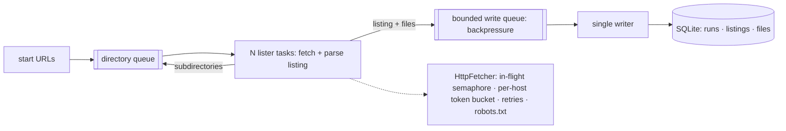

# Async Archive Mirror

Mirrors large public archives that are published as nested directory listings (Apache,
nginx and IIS autoindex pages), built as an asyncio pipeline: bounded queues for
backpressure, per-host rate limits kept separate from concurrency limits, robots.txt and
`Retry-After` handling, and durable SQLite state that makes every rerun idempotent.

**Status: milestone M0 is done.** That covers listing parsers for three server formats, a concurrent lister, the
SQLite state store and `--dry-run`. Next: resumable range downloads (M1), process-pool
extraction and graceful shutdown (M2), and a benchmark against the sequential original (M3).



## Quickstart

```bash
uv sync
make demo        # starts a local archive server and runs the real CLI against it, no internet needed
```

Against a real archive (please set a contact URL so admins can reach you):

```bash
export ARCHIVE_MIRROR_CONTACT_URL=https://github.com/<you>
uv run archive-mirror mirror https://mirror.example.org/pub/project/ --dry-run
uv run archive-mirror mirror --urls-file start-urls.txt --dry-run --json
```

In containers (non-root runtime image, plus the local archive server):

```bash
docker compose -f deploy/docker-compose.yml up --build --abort-on-container-exit
```

Every setting is an environment variable. See [`.env.example`](.env.example).

## A real run

`make demo` serves a synthetic archive of 85 directories and 2,125 files (4.84 GiB on
paper) as nginx listings, with 20 ms of latency per request, and runs the CLI against it:

```
               Dry run 20261118T155805Z-60bc5a
┌──────────────────────────────┬────────────────────────────┐
│ Directories listed           │                         85 │
│ Directories failed           │                          0 │
│ Directories skipped          │                          0 │
│ Listing formats              │                   nginx 85 │
│ Files                        │                      2,125 │
│ Total size                   │ 4.84 GiB (5,194,770,025 B) │
│   of which rounded by server │                    0 files │
│   size unknown               │                    0 files │
│ Archives                     │                        765 │
│ Already mirrored             │                          0 │
│ Elapsed                      │   1.56 s (54.3 listings/s) │
└──────────────────────────────┴────────────────────────────┘
```

That run was inside Docker. The tables below are from a Windows laptop over loopback, with
the rate cap lifted (`--rate 10000`). Each figure is the median of three runs.

| Listing workers | Wall time | Listings/s |
|---:|---:|---:|
| 1 | 4.43 s | 19.2 |
| 2 | 2.41 s | 35.3 |
| 4 | 2.08 s | 40.8 |
| 8 | 2.22 s | 38.3 |
| 16 | 2.13 s | 39.9 |

The curve flattens after 4 workers because the client becomes CPU-bound: process CPU time
equals wall time (1.67 s vs 1.71 s), mostly spent parsing HTML on the event loop. More
concurrency cannot fix that. Moving parsing off the loop can, which is planned with the process
pool in M2 and will be measured in M3. Details are in [docs/architecture.md](docs/architecture.md#measured-limits).

Same tree, each format, 4 workers:

| Format | Files | Total listed | Rounded sizes | Wall time |
|---|---:|---:|---:|---:|
| Apache | 2,125 | 5,193,686,029 B (0.02 % off the true total) | 2,125 | 2.75 s |
| nginx | 2,125 | 5,194,770,025 B (exact) | 0 | 1.88 s |
| IIS | 2,125 | 5,194,770,025 B (exact) | 0 | 2.01 s |

Politeness wins over concurrency: with 8 workers but a cap of 2 requests/s (burst 8), the
same 86 requests (85 listings plus robots.txt) took **39.5 s**. The token bucket predicts
(86 − 8) / 2 = 39 s.

## Design

The patterns this repo is built around, and where to see them:

| Pattern | Where |
|---|---|
| **Status state machine with SQL `CHECK`** | `domain/status.py` and `adapters/schema.sql`: `listed → downloading → done / failed`. Moves are checked in Python and run as compare-and-set `UPDATE … WHERE status = ?` |
| **Idempotent reruns, ids from upstream location** | `file_id = sha256(canonical URL)`, writes are upserts. A rerun keeps `first_seen_run`, moves `last_seen_run`, and sends a `done` file back to `listed` only if its size or date changed |
| **Budget before request** | depth, robots.txt and listing-page budget are checked before every fetch; listing bodies are capped while streaming |
| **Durable before visible** | one writer commits a listing and its files in one transaction, and counters, logs and metrics move only after the commit |
| **Provenance on every row** | each file records its listing URL, listing format and first/last run; each run stores its settings snapshot and tool version |
| **Politeness as config** | GCRA token bucket per host, a global in-flight semaphore, a host-wide pause on 429/503 that honours `Retry-After`, robots.txt per RFC 9309 including `Crawl-delay`, one honest User-Agent with a contact URL |
| **Structured concurrency** | `asyncio.TaskGroup` owns listers and writer; a bug in any of them cancels the rest and surfaces |
| **Backpressure** | the write queue is bounded, so listers stop fetching when the database falls behind (tested with a slow writer) |

Decisions and their trade-offs:

* [ADR 001: One SQLite writer behind a bounded queue](docs/adr/001-single-writer-sqlite-state.md)
* [ADR 002: Listing scope, canonical URLs and local paths](docs/adr/002-listing-scope-and-identity.md)
* [ADR 003: Politeness lives in the HTTP adapter](docs/adr/003-politeness-in-the-http-adapter.md)

More in [docs/architecture.md](docs/architecture.md).

### Supported listing formats

| Server | Layout | Sizes | Notes |
|---|---|---|---|
| Apache `mod_autoindex` | `HTMLTable`, `FancyIndexing` `<pre>`, plain `<ul>` | rounded (`1.2M`), flagged approximate | sort links and icon links ignored |
| nginx `autoindex` | `<pre>` | exact bytes (or rounded with `autoindex_exact_size off`) | names taken from the href, since link text is cut at 50 chars |
| IIS directory browsing | `<pre>`, metadata before the link | exact bytes | absolute hrefs; US, long and 24-hour date formats |

## Development

```bash
make dev                # uv sync + pre-commit hooks
make lint types test    # ruff, mypy --strict src/, pytest
```

The unit tests cover parsers (hand-written fixtures plus a Hypothesis round trip through
all three renderers), URL rules, backoff, the token bucket on a fake clock, the HTTP fetcher
with respx, robots.txt and the lister with fakes. The integration tests run the real HTTP
stack and SQLite against the local archive server in each format, including robots.txt,
503 retries, idempotent reruns and the rate limit measured in wall time. CI runs lint → types
→ unit → integration.

```
src/archive_mirror/  domain/ · services/ · adapters/ · composition.py · settings.py · cli.py
bench/               local archive server and demo runner
tests/               unit/ · integration/ · fixtures/
deploy/              multi-stage Dockerfile, docker-compose demo
docs/                architecture and ADRs
```
