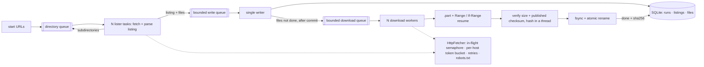

# Async Archive Mirror

Mirrors large public archives that are published as nested directory listings (Apache,
nginx and IIS autoindex pages), built as an asyncio pipeline: bounded queues for
backpressure, per-host rate limits kept separate from concurrency limits, robots.txt and
`Retry-After` handling, HTTP range requests that resume any interrupted file, checksum
verification, and durable SQLite state that makes every rerun idempotent.

**Status: milestones M0 and M1 are done.** It lists three server formats, downloads with
range resume and verification, and survives `kill -9` at any instant (20/20 randomized
kill-and-resume trials, byte for byte). Next: process-pool extraction and graceful
shutdown (M2), and a benchmark against the sequential original (M3).



## Quickstart

```bash
uv sync
make demo          # dry run of the real CLI against a local archive server, no internet needed
make demo-mirror   # the same, downloading and verifying every file
make kill-resume   # kill the CLI at random moments 20 times, resume, compare every byte
```

Against a real archive (please set a contact URL so admins can reach you):

```bash
export ARCHIVE_MIRROR_CONTACT_URL=https://github.com/<you>
uv run archive-mirror mirror https://mirror.example.org/pub/project/ --dry-run   # count and size
uv run archive-mirror mirror https://mirror.example.org/pub/project/             # download
uv run archive-mirror resume       # finish what the state file still has pending, no relisting
uv run archive-mirror mirror --urls-file start-urls.txt --json
```

Stop it any way you like (Ctrl+C, a crash, `kill -9`) and run the same command again:
finished files are skipped, partial ones continue from their last byte.

In containers (non-root runtime image, plus the local archive server):

```bash
docker compose -f deploy/docker-compose.yml up --build --abort-on-container-exit
```

Every setting is an environment variable. See [`.env.example`](.env.example).

## A real run

### Mirroring

The compose demo serves a synthetic archive of 21 directories and 420 files as nginx
listings, with 20 ms of latency per request and a published `.sha256` next to every data
file. The non-root runtime image mirrors all of it:

```
                 Mirror 20261118T200331Z-09c293
┌──────────────────────────────────┬────────────────────────────┐
│ Directories listed               │                         21 │
│ Directories failed               │                          0 │
│ Directories skipped              │                          0 │
│ Listing formats                  │                   nginx 21 │
│ Files                            │                        420 │
│ Total size                       │ 196.29 MiB (205,826,030 B) │
│   of which rounded by server     │                    0 files │
│   size unknown                   │                    0 files │
│ Archives                         │                         84 │
├──────────────────────────────────┼────────────────────────────┤
│ Downloaded this run              │                  420 files │
│   resumed from a .part           │                          0 │
│   verified by published checksum │                        210 │
│ Failed this run                  │                          0 │
│ Skipped (budget or disk)         │                          0 │
│ Received                         │   196.29 MiB (21.28 MiB/s) │
├──────────────────────────────────┼────────────────────────────┤
│ State: done                      │           420 (196.29 MiB) │
│ State: failed                    │                          0 │
│ State: still to download         │                          0 │
│ Elapsed                          │      9.23 s (45.5 files/s) │
└──────────────────────────────────┴────────────────────────────┘
```

The 210 sidecars themselves are verified by size, since nothing publishes a checksum of a
checksum. Run the same command again (`make demo-mirror` twice on a laptop) and it lists
all 21 directories, finds every file `done` and unchanged, and downloads nothing: 0 files
in 0.95 s.

### Kill and resume

`make kill-resume` runs the real CLI as a child process against 32 files (8.6 MB, each
response held to 3 MB/s so transfers are in flight). In each of 20 trials it kills the
process hard (TerminateProcess on Windows, SIGKILL on Linux) one to three times, at
uniform random points across the length of a clean run. Then it runs the CLI to the end
and compares every file's SHA-256 with the server's bytes.

| Trials | Kills that landed | Partial files left by kills | Range requests on resume | Byte-identical |
|---:|---:|---:|---:|---:|
| 20 | 37 | 39 | 28 | **20 / 20** |

Every trial also ends with no `.part` file left and every row `done` in the state file.
The same harness runs in the integration suite. Why it holds: [ADR 004](docs/adr/004-resumable-downloads.md).

### Listing speed

`make demo` dry-runs a bigger synthetic archive: 85 directories and 2,125 files (4.84 GiB on
paper) as nginx listings, with 20 ms of latency per request:

```
               Dry run 20261118T155805Z-60bc5a
┌──────────────────────────────┬────────────────────────────┐
│ Directories listed           │                         85 │
│ Directories failed           │                          0 │
│ Directories skipped          │                          0 │
│ Listing formats              │                   nginx 85 │
│ Files                        │                      2,125 │
│ Total size                   │ 4.84 GiB (5,194,770,025 B) │
│   of which rounded by server │                    0 files │
│   size unknown               │                    0 files │
│ Archives                     │                        765 │
│ Already mirrored             │                          0 │
│ Elapsed                      │   1.56 s (54.3 listings/s) │
└──────────────────────────────┴────────────────────────────┘
```

That dry run was captured in Docker. The tables below are from a Windows laptop over loopback, with
the rate cap lifted (`--rate 10000`). Each figure is the median of three runs.

| Listing workers | Wall time | Listings/s |
|---:|---:|---:|
| 1 | 4.43 s | 19.2 |
| 2 | 2.41 s | 35.3 |
| 4 | 2.08 s | 40.8 |
| 8 | 2.22 s | 38.3 |
| 16 | 2.13 s | 39.9 |

The curve flattens after 4 workers because the client becomes CPU-bound: process CPU time
equals wall time (1.67 s vs 1.71 s), mostly spent parsing HTML on the event loop. More
concurrency cannot fix that. Moving parsing off the loop can, which is planned with the process
pool in M2 and will be measured in M3. Details are in [docs/architecture.md](docs/architecture.md#measured-limits).

Same tree, each format, 4 workers:

| Format | Files | Total listed | Rounded sizes | Wall time |
|---|---:|---:|---:|---:|
| Apache | 2,125 | 5,193,686,029 B (0.02 % off the true total) | 2,125 | 2.75 s |
| nginx | 2,125 | 5,194,770,025 B (exact) | 0 | 1.88 s |
| IIS | 2,125 | 5,194,770,025 B (exact) | 0 | 2.01 s |

Politeness wins over concurrency: with 8 workers but a cap of 2 requests/s (burst 8), the
same 86 requests (85 listings plus robots.txt) took **39.5 s**. The token bucket predicts
(86 − 8) / 2 = 39 s.

## Design

The patterns this repo is built around, and where to see them:

| Pattern | Where |
|---|---|
| **Status state machine with SQL `CHECK`** | `domain/status.py` and `adapters/schema.sql`: `listed → downloading → done / failed`. Moves are checked in Python and run as compare-and-set `UPDATE … WHERE status = ?`. A `CHECK` makes `done` impossible without a SHA-256 and a size |
| **Idempotent reruns, ids from upstream location** | `file_id = sha256(canonical URL)`, writes are upserts. A rerun keeps `first_seen_run`, moves `last_seen_run`, and sends a `done` file back to `listed` only if its size or date changed. A rerun of a finished mirror downloads nothing |
| **Resumable streaming** | `<path>.part` plus the validator it came from; `Range` + `If-Range` on every retry and every later run; `206`/`200`/`416` each handled; raw bytes with `Accept-Encoding: identity` |
| **Budget before request** | depth, robots.txt and listing-page budget before every listing fetch; run byte budget and a free-disk floor before every download; listing bodies capped while streaming |
| **Durable before visible** | listings and their files commit in one transaction; a download is fsynced and atomically renamed *before* `done` is committed; counters, logs and metrics move only after the commit |
| **Verification** | size against the listing and the server's announced length; published checksums (`.sha256` sidecars, `SHA256SUMS`, GNU or BSD lines) when present; hashing runs in a thread. `verified_by` records what was checked |
| **Provenance on every row** | each file records its listing URL, listing format, first/last run, checksum URL, SHA-256, ETag and the run that downloaded it; each run stores its settings snapshot and tool version |
| **Politeness as config** | GCRA token bucket per host, a global in-flight semaphore, a host-wide pause on 429/503 that honours `Retry-After`, robots.txt per RFC 9309 including `Crawl-delay`, one honest User-Agent with a contact URL |
| **Structured concurrency** | `asyncio.TaskGroup`s own listers, writer and download workers; a bug in any of them cancels the rest and surfaces |
| **Backpressure** | bounded write and download queues: slow downloads block the writer, which blocks the listers (tested with slow fakes) |
| **Crash safety** | an OS lock gives one process per state file; on start, `downloading` rows go back to `listed` and their parts resume. Proven by 20/20 randomized hard kills |

Decisions and their trade-offs:

* [ADR 001: One SQLite writer behind a bounded queue](docs/adr/001-single-writer-sqlite-state.md)
* [ADR 002: Listing scope, canonical URLs and local paths](docs/adr/002-listing-scope-and-identity.md)
* [ADR 003: Politeness lives in the HTTP adapter](docs/adr/003-politeness-in-the-http-adapter.md)
* [ADR 004: Resumable downloads, and when a file counts as done](docs/adr/004-resumable-downloads.md)

More in [docs/architecture.md](docs/architecture.md).

### Supported listing formats

| Server | Layout | Sizes | Notes |
|---|---|---|---|
| Apache `mod_autoindex` | `HTMLTable`, `FancyIndexing` `<pre>`, plain `<ul>` | rounded (`1.2M`), flagged approximate | sort links and icon links ignored |
| nginx `autoindex` | `<pre>` | exact bytes (or rounded with `autoindex_exact_size off`) | names taken from the href, since link text is cut at 50 chars |
| IIS directory browsing | `<pre>`, metadata before the link | exact bytes | absolute hrefs; US, long and 24-hour date formats |

## Development

```bash
make dev                # uv sync + pre-commit hooks
make lint types test    # ruff, mypy --strict src/, pytest
uv run pytest -m "not slow"   # everything except the kill-and-resume trials
```

The unit tests cover parsers (hand-written fixtures plus a Hypothesis round trip through
all three renderers), URL rules, byte ranges, checksum files, size tolerance (Hypothesis
against Apache's rounding), backoff, the token bucket on a fake clock, the HTTP fetcher and
the range-resume protocol with respx, part files on disk, robots.txt, and the lister and
downloader with fakes. The integration tests run the real HTTP stack, SQLite and disk
against the local archive server: every format, robots.txt, 503 retries, connections cut
mid-body (with and without validators, and with a server that ignores `Range`), a corrupted
body caught by its checksum, upstream changes, idempotent reruns, `resume`, the state
lock, a schema migration, the rate limit in wall time, and the 20 kill-and-resume trials.
CI runs lint → types → unit → integration.

```
src/archive_mirror/  domain/ · services/ · adapters/ · composition.py · settings.py · cli.py
bench/               local archive server, demo runner, kill-and-resume harness
tests/               unit/ · integration/ · fixtures/
deploy/              multi-stage Dockerfile, docker-compose demo
docs/                architecture and ADRs
```
