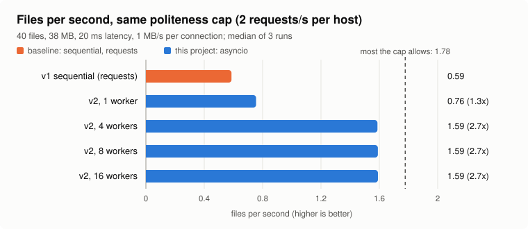

# Async Archive Mirror

Mirrors large public archives that are published as nested directory listings (Apache,
nginx and IIS autoindex pages), built as an asyncio pipeline: bounded queues for
backpressure, per-host rate limits kept separate from concurrency limits, robots.txt and
`Retry-After` handling, HTTP range requests that resume any interrupted file, checksum
verification, archives unpacked in worker processes off the event loop, a two-step Ctrl+C,
and durable SQLite state that makes every rerun idempotent.

**Status: milestones M0 to M3 are done.** It lists three server formats, downloads with
range resume and verification, and unpacks zip, tar and 7z archives in a process pool. It
survives `kill -9` at any instant (20/20 randomized kill-and-resume trials, byte for byte),
stops cleanly on Ctrl+C or `docker stop`, and mirrors **2.7x faster than the sequential tool
it replaces under the same politeness cap** (11.5x with the cap lifted).

## Benchmark



| Run | Wall time | Files/s | MB/s | Peak RSS | vs baseline |
|---|---:|---:|---:|---:|---:|
| baseline: sequential, `requests` | 68.2 s | 0.59 | 0.56 | 35 MiB | 1.0x |
| this project, 1 worker | 53.0 s | 0.76 | 0.73 | 68 MiB | 1.3x |
| this project, 4 workers | 25.2 s | 1.59 | 1.52 | 69 MiB | **2.7x** |
| this project, 8 workers | 25.2 s | 1.59 | 1.53 | 69 MiB | 2.7x |
| this project, 16 workers | 25.2 s | 1.59 | 1.53 | 70 MiB | 2.7x |
| this project, 16 workers, no cap (for scale only) | 5.9 s | 6.73 | 6.46 | 73 MiB | 11.5x |

**Setup.** A local archive server holds 40 files (38 MB) in IIS listings, with 20 ms of
latency per request and every response held to 1 MB/s, like a remote mirror whose
per-connection bandwidth is the limit. Each run starts in its own process from an empty
directory. Every mirrored file is checked by SHA-256 before the run counts. Median of
3 rounds on a Windows laptop. Wall time includes each program's own imports (about 2.5 s for
this project here).

**The baseline** ([`bench/v1_sequential.py`](bench/v1_sequential.py)) reimplements the tool
this project replaces, faithfully: one `requests` session, a depth-first crawl that sleeps
0.2 s before each listing, then one download after another with a 0.5 s sleep before each.
So it never asks for more than **2 files a second**. This project gets the same ceiling:
`per_host_rate=2`, no burst, for listings and robots.txt too. Archive extraction is off on
both sides (the baseline unpacked in a separate script).

**Reading it.**
* One worker is already 1.3x: the token bucket only waits when a request would start too
  early, while the baseline adds its sleep on top of every transfer.
* From 4 workers on, transfers overlap and the run sits at the cap: 45 requests at 2 per
  second take 22 s, plus imports and the last transfer. 8 and 16 workers cannot beat it,
  and they should not. Concurrency is how much we wait in parallel; the rate is what
  the server sees (ADR 003).
* Lifting the cap shows what the pipeline can do: 16 workers fill 16 connections and finish
  in 5.9 s. Do not run that against someone else's server.
* Peak memory is about twice the baseline's (httpx, pydantic, SQLite state, rich progress),
  and it stays flat from 1 to 16 workers: the queues are bounded.

`make bench` reruns it all and redraws the chart. Raw numbers are in
[`docs/benchmark/results.json`](docs/benchmark/results.json).

**Where parsing runs.** BeautifulSoup holds the GIL, and a 1,000-entry Apache listing takes
0.8 s to parse, which used to stall every download for that long. Pages of 8 KiB or more now
go to their own process pool: in a dry run of nine such directories the worst event-loop
stall fell from 2.9 s to 0.23 s. Measured with `make parse-cost`, decided in
[ADR 006](docs/adr/006-large-listings-parse-in-a-process-pool.md).

```mermaid
flowchart LR
  START[start URLs] --> DQ[[directory queue]]
  DQ --> L[N lister tasks: fetch + parse listing]
  L -- subdirectories --> DQ
  L -- "listing + files" --> WQ[[bounded write queue]]
  WQ --> W[single writer] --> DB[(SQLite: runs · listings · files)]
  W -- "files not done, after commit" --> FQ[[bounded download queue]]
  FQ --> D[N download workers]
  D --> P[.part + Range / If-Range resume]
  P --> V[verify size + published checksum, hash in a thread]
  V --> R[fsync + atomic rename] -- "done + sha256" --> DB
  R -- "archives, after commit" --> XQ[[bounded extract queue]]
  XQ --> X[N extract workers] --> PP[ProcessPoolExecutor: zip · tar · 7z, into .extracting, then rename]
  PP -- "extracted + counts" --> DB
  L & D -.-> HTTP[HttpFetcher: in-flight semaphore · per-host token bucket · retries · robots.txt]
```



## Quickstart

```bash
uv sync
make demo              # dry run of the real CLI against a local archive server, no internet needed
make demo-mirror       # the same, downloading, verifying and unpacking, with live progress bars
make interrupt-resume  # Ctrl+C the CLI mid-run, check nothing is half-done, resume, compare every byte
make bench             # the benchmark above: baseline vs this project, then the chart
make kill-resume       # kill the CLI at random moments 20 times, resume, compare every byte
```

Against a real archive (please set a contact URL so admins can reach you):

```bash
export ARCHIVE_MIRROR_CONTACT_URL=https://github.com/<you>
uv run archive-mirror mirror https://mirror.example.org/pub/project/ --dry-run   # count and size
uv run archive-mirror mirror https://mirror.example.org/pub/project/             # download
uv run archive-mirror resume       # finish what the state file still has pending, no relisting
uv run archive-mirror mirror --urls-file start-urls.txt --json
```

Stop it any way you like (Ctrl+C, a crash, `kill -9`) and run the same command again:
finished files are skipped, partial ones continue from their last byte, and archives not
yet unpacked are unpacked. Ctrl+C (or SIGTERM) once stops cleanly within moments and exits
130. A second Ctrl+C stops at once.

In containers (non-root runtime image, plus the local archive server):

```bash
docker compose -f deploy/docker-compose.yml up --build --abort-on-container-exit
```

Every setting is an environment variable. See [`.env.example`](.env.example).

## A real run

### Mirroring

The compose demo serves a synthetic archive of 21 directories and 420 files as nginx
listings, with 20 ms of latency per request and a published `.sha256` next to every data
file. The non-root runtime image mirrors all of it:

```
                 Mirror 20261118T200331Z-09c293
┌──────────────────────────────────┬────────────────────────────┐
│ Directories listed               │                         21 │
│ Directories failed               │                          0 │
│ Directories skipped              │                          0 │
│ Listing formats                  │                   nginx 21 │
│ Files                            │                        420 │
│ Total size                       │ 196.29 MiB (205,826,030 B) │
│   of which rounded by server     │                    0 files │
│   size unknown                   │                    0 files │
│ Archives                         │                         84 │
├──────────────────────────────────┼────────────────────────────┤
│ Downloaded this run              │                  420 files │
│   resumed from a .part           │                          0 │
│   verified by published checksum │                        210 │
│ Failed this run                  │                          0 │
│ Skipped (budget or disk)         │                          0 │
│ Received                         │   196.29 MiB (21.28 MiB/s) │
├──────────────────────────────────┼────────────────────────────┤
│ State: done                      │           420 (196.29 MiB) │
│ State: failed                    │                          0 │
│ State: still to download         │                          0 │
│ Elapsed                          │      9.23 s (45.5 files/s) │
└──────────────────────────────────┴────────────────────────────┘
```

The 210 sidecars themselves are verified by size, since nothing publishes a checksum of a
checksum. Run the same command again (`make demo-mirror` twice on a laptop) and it lists
all 21 directories, finds every file `done` and unchanged, and downloads nothing: 0 files
in 0.95 s.

### Kill and resume

`make kill-resume` runs the real CLI as a child process against 32 files (8.6 MB, each
response held to 3 MB/s so transfers are in flight). In each of 20 trials it kills the
process hard (TerminateProcess on Windows, SIGKILL on Linux) one to three times, at
uniform random points across the length of a clean run. Then it runs the CLI to the end
and compares every file's SHA-256 with the server's bytes.

| Trials | Kills that landed | Partial files left by kills | Range requests on resume | Byte-identical |
|---:|---:|---:|---:|---:|
| 20 | 37 | 39 | 28 | **20 / 20** |

Every trial also ends with no `.part` file left and every row `done` in the state file.
The same harness runs in the integration suite. Why it holds: [ADR 004](docs/adr/004-resumable-downloads.md).
A rerun of the harness in M2 gave 20/20 again: 35 kills landed, 62 partial files resumed, 45
range requests.

### Unpacking, and Ctrl+C

With `--real-archives`, the local server's `.tar.gz` files are real archives, so each
unpacked member can be compared with what the server packed. On the same 420-file tree as
above, on a Windows laptop over loopback, the run unpacks all 84 archives (168 files,
78.96 MiB) in worker processes while downloads keep streaming:

| Run (one each) | Wall time | Archives unpacked |
|---|---:|---:|
| extraction off | 10.91 s | 0 |
| extraction on, 2 worker processes | 11.75 s | 84 |

Stopping is tested on the real CLI. `make interrupt-resume` starts it as a child process,
waits until a few files are done, and sends the signal a person would (SIGINT, or Ctrl+Break
on Windows). The CLI must exit 130 on its own, with no row left `downloading` or
`extracting` and the run recorded `interrupted`. A second run then finishes, and every file
and every unpacked member is compared byte for byte.

In containers, `docker compose stop` sends SIGTERM to the mirror. Four stop-and-resume
cycles on the compose demo, each stopped at a different point after the first download:

| Cycles | Exit code after SIGTERM | Resume exit code | Rows the resume had to recover | Files done | Archives unpacked |
|---:|---:|---:|---:|---:|---:|
| 4 | 130 (all 4) | 0 (all 4) | **0** | 420/420 | 84/84 |

Getting the recovery count to zero took one fix that only a real stop exposed. The first
attempt left one archive in `extracting`: a SQLite commit landed after its caller had
already been cancelled. Claims and final status writes now run under `asyncio.shield`
([ADR 005](docs/adr/005-graceful-shutdown-and-extraction-workers.md)), and
`tests/unit/test_writes.py` reproduces that window.

### Listing speed

`make demo` dry-runs a bigger synthetic archive: 85 directories and 2,125 files (4.84 GiB on
paper) as nginx listings, with 20 ms of latency per request:

```
               Dry run 20261118T155805Z-60bc5a
┌──────────────────────────────┬────────────────────────────┐
│ Directories listed           │                         85 │
│ Directories failed           │                          0 │
│ Directories skipped          │                          0 │
│ Listing formats              │                   nginx 85 │
│ Files                        │                      2,125 │
│ Total size                   │ 4.84 GiB (5,194,770,025 B) │
│   of which rounded by server │                    0 files │
│   size unknown               │                    0 files │
│ Archives                     │                        765 │
│ Already mirrored             │                          0 │
│ Elapsed                      │   1.56 s (54.3 listings/s) │
└──────────────────────────────┴────────────────────────────┘
```

That dry run was captured in Docker. The tables below are from a Windows laptop over loopback, with
the rate cap lifted (`--rate 10000`). Each figure is the median of three runs.

| Listing workers | Wall time | Listings/s |
|---:|---:|---:|
| 1 | 4.43 s | 19.2 |
| 2 | 2.41 s | 35.3 |
| 4 | 2.08 s | 40.8 |
| 8 | 2.22 s | 38.3 |
| 16 | 2.13 s | 39.9 |

The curve flattens after 4 workers because the client becomes CPU-bound: process CPU time
equals wall time (1.67 s vs 1.71 s), mostly spent parsing HTML on the event loop. More
concurrency cannot fix that. Moving parsing off the loop might. A 25-entry page costs 4-5 ms
to parse for nginx and IIS and about 20 ms for Apache. In a pool of 4, an Apache page costs
7.4 ms of wall time, after 1.3 s of process start. Whether that pays off is for the M3
benchmark. Details are in [docs/architecture.md](docs/architecture.md#measured-limits).

Same tree, each format, 4 workers:

| Format | Files | Total listed | Rounded sizes | Wall time |
|---|---:|---:|---:|---:|
| Apache | 2,125 | 5,193,686,029 B (0.02 % off the true total) | 2,125 | 2.75 s |
| nginx | 2,125 | 5,194,770,025 B (exact) | 0 | 1.88 s |
| IIS | 2,125 | 5,194,770,025 B (exact) | 0 | 2.01 s |

Politeness wins over concurrency: with 8 workers but a cap of 2 requests/s (burst 8), the
same 86 requests (85 listings plus robots.txt) took **39.5 s**. The token bucket predicts
(86 − 8) / 2 = 39 s.

## Design

The patterns this repo is built around, and where to see them:

| Pattern | Where |
|---|---|
| **Status state machine with SQL `CHECK`** | `domain/status.py` and `adapters/schema.sql`: `listed → downloading → done / failed`, and for archives `pending → extracting → done / failed / unsupported`. Moves are checked in Python and run as compare-and-set `UPDATE … WHERE status = ?`. `CHECK`s make `done` impossible without a SHA-256 and a size, and an extracted archive impossible without its counts |
| **Idempotent reruns, ids from upstream location** | `file_id = sha256(canonical URL)`, writes are upserts. A rerun keeps `first_seen_run`, moves `last_seen_run`, and sends a `done` file back to `listed` only if its size or date changed. A rerun of a finished mirror downloads nothing |
| **Resumable streaming** | `<path>.part` plus the validator it came from; `Range` + `If-Range` on every retry and every later run; `206`/`200`/`416` each handled; raw bytes with `Accept-Encoding: identity` |
| **Budget before request** | depth, robots.txt and listing-page budget before every listing fetch; run byte budget and a free-disk floor before every download; listing bodies capped while streaming |
| **Durable before visible** | listings and their files commit in one transaction; a download is fsynced and atomically renamed *before* `done` is committed; an archive is unpacked into `<target>.extracting/` and renamed when complete; counters, logs and metrics move only after the commit |
| **Verification** | size against the listing and the server's announced length; published checksums (`.sha256` sidecars, `SHA256SUMS`, GNU or BSD lines) when present; hashing runs in a thread. `verified_by` records what was checked |
| **Provenance on every row** | each file records its listing URL, listing format, first/last run, checksum URL, SHA-256, ETag and the run that downloaded it; each run stores its settings snapshot and tool version |
| **Politeness as config** | GCRA token bucket per host, a global in-flight semaphore, a host-wide pause on 429/503 that honours `Retry-After`, robots.txt per RFC 9309 including `Crawl-delay`, one honest User-Agent with a contact URL |
| **Structured concurrency** | `asyncio.TaskGroup`s own listers, writer, download and extract workers; a bug in any of them cancels the rest and surfaces |
| **Backpressure** | bounded write, download and extract queues: slow extraction blocks downloads, which block the writer, which blocks the listers (tested with slow fakes) |
| **CPU off the loop** | archives unpacked in a `ProcessPoolExecutor` (`spawn`, workers ignore Ctrl+C); listing pages of 8 KiB or more parsed in a second pool (ADR 006); hashing, fsync and rename in threads |
| **Untrusted archives** | member names that are absolute, have a drive letter or contain `..` are skipped; links and devices skipped; bytes and members capped per archive and counted while writing (zip bomb tested) |
| **Graceful shutdown** | first Ctrl+C/SIGTERM cancels through every `TaskGroup`: transfers roll back to `listed` and keep their `.part`, verified files finish, extractions roll back to `pending`, the run is recorded `interrupted`, exit 130. Status writes are shielded so a cancel never splits one. Second Ctrl+C: immediate |
| **Crash safety** | an OS lock gives one process per state file; on start, `downloading` rows go back to `listed` and their parts resume, `extracting` rows go back to `pending`. Proven by 20/20 randomized hard kills |
| **Live progress** | `--progress` (on in a terminal): listing, downloads with bytes/s, extraction; read from the services' counters, which know nothing about it |

Decisions and their trade-offs:

* [ADR 001: One SQLite writer behind a bounded queue](docs/adr/001-single-writer-sqlite-state.md)
* [ADR 002: Listing scope, canonical URLs and local paths](docs/adr/002-listing-scope-and-identity.md)
* [ADR 003: Politeness lives in the HTTP adapter](docs/adr/003-politeness-in-the-http-adapter.md)
* [ADR 004: Resumable downloads, and when a file counts as done](docs/adr/004-resumable-downloads.md)
* [ADR 005: Graceful shutdown, and archives unpacked in worker processes](docs/adr/005-graceful-shutdown-and-extraction-workers.md)
* [ADR 006: Large listing pages are parsed in a process pool](docs/adr/006-large-listings-parse-in-a-process-pool.md)

More in [docs/architecture.md](docs/architecture.md).

### Supported listing formats

| Server | Layout | Sizes | Notes |
|---|---|---|---|
| Apache `mod_autoindex` | `HTMLTable`, `FancyIndexing` `<pre>`, plain `<ul>` | rounded (`1.2M`), flagged approximate | sort links and icon links ignored |
| nginx `autoindex` | `<pre>` | exact bytes (or rounded with `autoindex_exact_size off`) | names taken from the href, since link text is cut at 50 chars |
| IIS directory browsing | `<pre>`, metadata before the link | exact bytes | absolute hrefs; US, long and 24-hour date formats |

### Supported archive formats

| Format | Suffixes | Notes |
|---|---|---|
| zip | `.zip` | encrypted archives are `failed` with the reason |
| tar | `.tar`, `.tar.gz`, `.tgz`, `.tar.bz2`, `.tbz2`, `.tar.xz`, `.txz` | links, devices and fifos skipped |
| single compressed file | `.gz`, `.bz2`, `.xz` | `notes.txt.gz` unpacks to `notes.txt` |
| 7z | `.7z` | via py7zr; members with unsafe names skipped, encrypted archives `failed` |
| rar | `.rar` | recognised and recorded `unsupported`: no decoder that needs no external tool |

## Development

```bash
make dev                # uv sync + pre-commit hooks
make lint types test    # ruff, mypy --strict src/, pytest
uv run pytest -m "not slow"   # everything except the kill-and-resume trials
```

The unit tests cover parsers (hand-written fixtures plus a Hypothesis round trip through
all three renderers), URL rules, byte ranges, checksum files, size tolerance (Hypothesis
against Apache's rounding), backoff, the token bucket on a fake clock, the HTTP fetcher and
the range-resume protocol with respx, part files on disk, robots.txt, archive unpacking
in every format with hostile input (path traversal, links, a zip bomb, too many members,
corrupt files, leftovers of a killed attempt), the two-step shutdown, cancellation landing
mid-write, where a listing page is parsed (loop or pool, by size), and the lister,
downloader and extractor with fakes. The integration tests run
the real HTTP stack, SQLite, disk and process pools against the local archive server: every
format with parsing on the loop and in the pool, robots.txt, 503 retries, connections cut mid-body (with and without validators, and
with a server that ignores `Range`), a corrupted body caught by its checksum, upstream
changes, idempotent reruns, `resume`, unpacking real archives and a backlog of earlier
ones, the state lock, schema migrations from versions 1 and 2, the rate limit in wall time,
Ctrl+C then resume on the real CLI, the benchmark baseline mirroring byte for byte, and the
20 kill-and-resume trials. CI runs lint →
types → unit → integration.

```
src/archive_mirror/  domain/ · services/ · adapters/ · composition.py · settings.py · cli.py
bench/               local archive server (real .tar.gz on request), demo runner, kill-and-resume
                     harness, sequential baseline, benchmark, chart, parse-cost measurement
tests/               unit/ · integration/ · fixtures/
deploy/              multi-stage Dockerfile, docker-compose demo
docs/                architecture and ADRs
```
