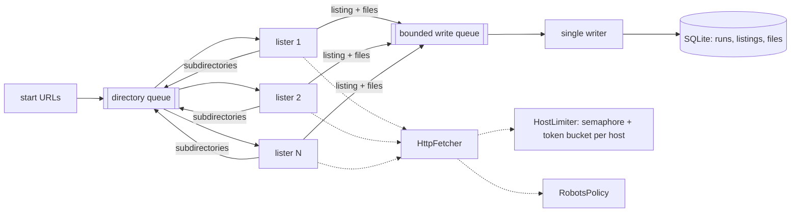
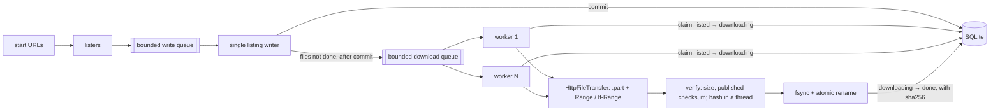

# Architecture

## Layers

```
src/archive_mirror/
  domain/      pure types and rules: URLs, sizes, backoff, byte ranges, checksum files,
               the status state machine. No I/O.
  services/    use cases (lister, downloader) and the ports they need (services/ports.py)
  adapters/    all I/O: HTTP fetcher and range downloads, rate limiter, robots.txt, checksum
               files, listing parsers, part files on disk, SQLite store and its lock
  composition.py   wires adapters into services; the only module that knows concrete classes
  settings.py      pydantic-settings; the only reader of environment variables
  cli.py, report.py  Typer entry point; tables and JSON
bench/         local archive server (listings, file bodies, ranges, faults), demo runner,
               kill-and-resume harness
```

Services take their adapters through the constructor (`Lister(fetcher=..., parse=...,
policy=..., writer=...)`, `Downloader(transfer=..., storage=..., checksums=..., state=...)`). The unit tests hand them fakes, and the integration tests use the
real ones against the local server.

## Data flow of a dry run



1. Each start URL becomes a directory URL with a trailing slash. Duplicates are dropped.
2. A lister takes a directory from the queue and checks, in order: depth limit, robots.txt,
   the listing-page budget. Only then does it fetch.
3. The page is parsed by the detected format. Subdirectories inside the start root go back
   on the directory queue. Files become `RemoteFile`s with id, local path and provenance.
4. The visit goes to the bounded write queue. The single writer stores the listing row and
   its files in one transaction, then updates counters and logs.
5. When the directory queue's `join()` returns, every visit is already in the write queue.
   Sentinels stop the listers and then the writer, and the `TaskGroup` exits.

## Data flow of a mirror run



1. Listing works as in a dry run. After the writer commits a listing, it puts the files that
   are not `done` on the bounded download queue. A full queue blocks the writer, which blocks
   the listers: backpressure from the disk all the way back to the crawl.
2. A worker checks the byte budget and the free-disk floor, then claims the file with a
   compare-and-set (`listed|failed → downloading`, attempts + 1).
3. `HttpFileTransfer` brings `<path>.part` up to the full length. It resumes any bytes
   already on disk with `Range` and `If-Range`; a dropped connection is retried the same way.
4. The part is hashed in a thread and checked against the listing size, the size the server
   announced, and the published checksum if there is one.
5. fsync, `os.replace` onto the final path, then `done` is committed with the digest.

`archive-mirror resume` skips step 1 and feeds the queue from the state file instead
(`pending_files()`, keyset-paged), so no listing is fetched again.

The resume protocol and its ordering rules are in
[ADR 004](adr/004-resumable-downloads.md).

## State

| Table | Key | Status (`CHECK`) | Provenance |
|---|---|---|---|
| `runs` | `run_id` | `running` · `completed` · `failed` · `interrupted` | settings snapshot, tool version, start URLs |
| `listings` | canonical URL | `listed` · `failed` · `skipped` | depth, parent, format, attempts, reason, first/last run |
| `files` | `sha256(canonical URL)` | `listed` · `downloading` · `done` · `failed` | listing URL, listing format, first/last run, checksum URL, SHA-256, `verified_by`, ETag, done run |

Schema version 2 added the download columns. `PRAGMA user_version` drives migrations
(`adapters/state_sql.py`). A test checks that a migrated version 1 file ends up with the same
columns and indexes as a new one. `CHECK`s make a `done` row without a 64-character
SHA-256 and a size impossible.

The file state machine (`domain/status.py`):

```
listed -> downloading -> done
              |  \-> failed -> downloading | listed
              \-> listed            (interrupted, rolled back)
done -> listed                      (upstream size or date changed; set by the upsert)
```

`SqliteStateStore.transition()` checks the move against that table, then runs it as a
compare-and-set (`UPDATE ... WHERE status = ?`), so two workers cannot both claim a file.
Only `mark_done()` reaches `done`, and it records the proof. Every write runs inside one
`asyncio.Lock`, so the listing writer's transactions and the workers' transitions never
share an open transaction on the single connection.

On start, a run takes an OS lock on `<state db>.lock`, then marks older `running` runs as
`interrupted` and moves `downloading` files back to `listed` (their part files are resumed).

## Concurrency

* `asyncio.TaskGroup` owns the listers and the writer, and an outer one owns the download
  workers and the crawl. An unexpected error in any of them cancels the rest and surfaces
  (tested with a failing writer and a failing feed).
* Rate vs concurrency for downloads: a download holds its in-flight slot for as long as its
  body streams, so `max_in_flight` caps open connections, while the token bucket still
  caps how many requests start per second.
* CPU off the loop: hashing a finished file runs in `asyncio.to_thread`. Writes of each
  network read stay on the loop: they land in the page cache in microseconds. fsync and
  rename run in a thread.
* Expected failures (HTTP errors, timeouts, unparseable pages, a failed verification, a local
  error on one file) are data, not exceptions: they become `failed` rows with the reason and
  the attempt count, and the run continues.
* Backpressure: the write queue is bounded. A test with a slow writer and a queue of 1 shows
  listers never get more than `workers + queue + 1` listings ahead of the database.

## Measured limits

* Against the local server (85 listings, 2,125 files, 20 ms latency), wall time stops falling
  after 4 workers. Process CPU time equals wall time at that point (1.67 s CPU, 1.71 s wall),
  so the event loop is CPU-bound. The cost is mostly HTML parsing and URL handling, about 5 ms per
  25-entry page. More concurrency cannot help a CPU-bound loop. Parsing moves to a process
  pool with the extraction work in M2, and the benchmark in M3 measures the change.
* Profiling also found httpcore re-importing a missing `sniffio` on every request (about 1.1 s per
  400 requests). `sniffio` is now an explicit dependency, see `pyproject.toml`.

## Observability

* structlog to stderr. `run_id` is bound in a context variable and appears on every line, also in
  tasks started by the `TaskGroup`. Set `ARCHIVE_MIRROR_LOG_JSON=true` for JSON lines.
* Prometheus on `/metrics` when `ARCHIVE_MIRROR_METRICS_PORT` is set: requests by host and
  outcome, retries, rate-limit wait histogram, listings by status and format, files
  recorded, queue depths, file bytes received by host, range resumes, files finished by
  outcome.
