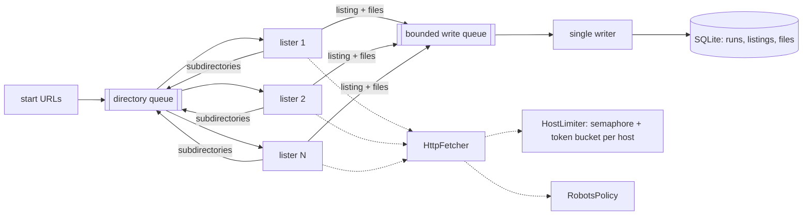

# Architecture

## Layers

```
src/archive_mirror/
  domain/      pure types and rules: URLs, sizes, backoff, status state machine. No I/O.
  services/    use cases (the lister) and the ports they need (services/ports.py)
  adapters/    all I/O: HTTP fetcher, rate limiter, robots.txt, listing parsers, SQLite store
  composition.py   wires adapters into services; the only module that knows concrete classes
  settings.py      pydantic-settings; the only reader of environment variables
  cli.py           Typer entry point
bench/         local archive server (Apache, nginx, IIS listings) and the demo runner
```

Services take their adapters through the constructor (`Lister(fetcher=..., parse=...,
policy=..., writer=...)`). The unit tests hand them fakes, and the integration tests use the
real ones against the local server.

## Data flow of a dry run



1. Each start URL becomes a directory URL with a trailing slash. Duplicates are dropped.
2. A lister takes a directory from the queue and checks, in order: depth limit, robots.txt,
   the listing-page budget. Only then does it fetch.
3. The page is parsed by the detected format. Subdirectories inside the start root go back
   on the directory queue. Files become `RemoteFile`s with id, local path and provenance.
4. The visit goes to the bounded write queue. The single writer stores the listing row and
   its files in one transaction, then updates counters and logs.
5. When the directory queue's `join()` returns, every visit is already in the write queue.
   Sentinels stop the listers and then the writer, and the `TaskGroup` exits.

## State

| Table | Key | Status (`CHECK`) | Provenance |
|---|---|---|---|
| `runs` | `run_id` | `running` · `completed` · `failed` · `interrupted` | settings snapshot, tool version, start URLs |
| `listings` | canonical URL | `listed` · `failed` · `skipped` | depth, parent, format, attempts, reason, first/last run |
| `files` | `sha256(canonical URL)` | `listed` · `downloading` · `done` · `failed` | listing URL, listing format, first/last run |

The file state machine (`domain/status.py`) is ready for M1:

```
listed -> downloading -> done
              |  \-> failed -> downloading | listed
              \-> listed            (interrupted, rolled back)
done -> listed                      (upstream size or date changed; set by the upsert)
```

`SqliteStateStore.transition()` checks the move against that table, then runs it as a
compare-and-set (`UPDATE ... WHERE status = ?`), so two workers cannot both claim a file.

## Concurrency

* `asyncio.TaskGroup` owns the listers and the writer. An unexpected error in one cancels the
  rest and is raised from `crawl()` (tested with a failing writer).
* Expected failures (HTTP errors, timeouts, unparseable pages) are data, not exceptions: they
  become `failed` listing rows with the reason and the attempt count.
* Backpressure: the write queue is bounded. A test with a slow writer and a queue of 1 shows
  listers never get more than `workers + queue + 1` listings ahead of the database.

## Measured limits

* Against the local server (85 listings, 2,125 files, 20 ms latency), wall time stops falling
  after 4 workers. Process CPU time equals wall time at that point (1.67 s CPU, 1.71 s wall),
  so the event loop is CPU-bound. The cost is mostly HTML parsing and URL handling, about 5 ms per
  25-entry page. More concurrency cannot help a CPU-bound loop. Parsing moves to a process
  pool with the extraction work in M2, and the benchmark in M3 measures the change.
* Profiling also found httpcore re-importing a missing `sniffio` on every request (about 1.1 s per
  400 requests). `sniffio` is now an explicit dependency, see `pyproject.toml`.

## Observability

* structlog to stderr. `run_id` is bound in a context variable and appears on every line, also in
  tasks started by the `TaskGroup`. Set `ARCHIVE_MIRROR_LOG_JSON=true` for JSON lines.
* Prometheus on `/metrics` when `ARCHIVE_MIRROR_METRICS_PORT` is set: requests by host and
  outcome, retries, rate-limit wait histogram, listings by status and format, files
  recorded, queue depths.
